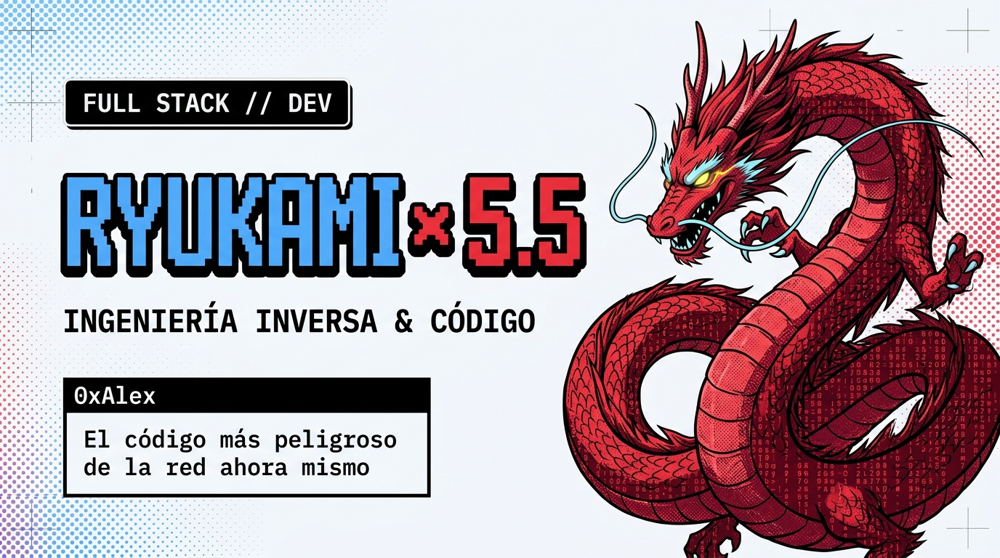

# 🐉 Ryukami-UI (Scorch Dragon Edition)

> **Retro TUI & Neo-Brutalism Component Library for modern Astro, Next.js & Web apps.**  
> Inspired by Velgrynd Scorch lore, 8-bit CRT monitors, and raw engineering aesthetics.



---

## ⚡ Filosofía de Diseño

1. **Neo-Brutalismo Puro:** Bordes rígidos de 2px, esquinas cuadradas (`border-radius: 0px`) y sombras sólidas hacia la izquierda-abajo (`-4px 4px 0px`).
2. **Terminal Retro TUI:** Marcos de ventana con cabecera de consola (`[ _ ][ □ ][ × ]`), tablas de datos ASCII y fuentes pixel-art.
3. **Mascota & Mitología Ryukami Scorch (Velgrynd Tribute):** Dragón oriental carmesí cuyas escamas se sombrean mediante código ASCII, combinando rojo carmesí (`#E63946`), cian eléctrico (`#4DA3FF`) y oro dragón (`#F4D35E`).
4. **Física Táctil con Web Audio API:** Clics mecánicos sintetizados en tiempo real sin cargar archivos MP3.

---

## 🚀 Inicio Rápido

### 1. Clonar e Instalar Dependencias

```bash
git clone https://github.com/alexwce/ryukami-ui.git
cd ryukami-ui
pnpm install
```

### 2. Modo de Desarrollo Local

```bash
pnpm dev
```
Abre tu navegador en `http://localhost:4321`.

### 3. Compilar para Producción

```bash
pnpm build
```

---

## 📦 Componentes Incluidos

- 🔘 **Button (`<Button variant="crimson|cyan|gold|dark|outline">`):** Botón mecánico con sonido de click táctil.
- 🏷️ **Badge (`<Badge variant="...">`):** Pastillas de estado y etiquetas de tecnologías.
- 🪟 **Card (`<Card title="..." status="...">`):** Ventana de consola TUI con controles retro.
- 📊 **Table:** Tabla de datos estilo salida ASCII de terminal.
- ⌨️ **Kbd (`<Kbd>`):** Teclas físicas de atajos de teclado.

---

## ⚖️ Licencia y Propiedad Intelectual

Distribuido bajo licencia **MIT License**.  
*Velgrynd Tribute Edition:* Homenaje y tributo visual libre de copyright directo, articulado bajo la marca original **Ryukami Labs**.
